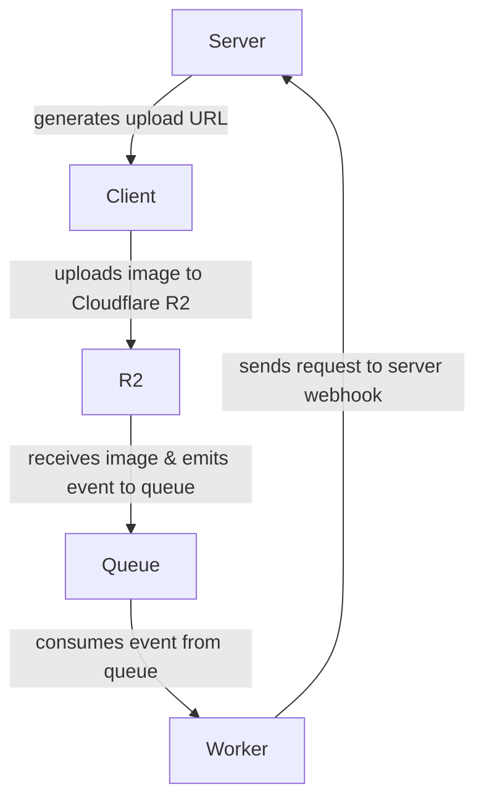

# Nautilus
- Nautilus is a platform that allows users to post information about their Minecraft servers and search for servers shared by others.
- This is a personal project I built to learn Spring Boot and its ecosystem. Because of that, it's not professional—expect bad APIs, AI slop UI (since I focused mainly on the backend and used AI for the frontend), etc.

# Requirements
- Docker
- Docker Compose
- FGA CLI

# How to run
- You need to create two `.env` files matching the `.env.example` files in `nautilus-client` and `nautilus-server`, then fill in your secret credentials.
- Note: Instructions for the OpenFGA-related values are provided in the section below.
- The directory structure should look like this:

```text
nautilus/
├── nautilus-client/
│   └── .env
└── nautilus-server/
    └── .env

```
## Server

* To run the server, navigate into the `nautilus-server` directory and run:

```bash
docker compose up -d

```

* On the first run, the authorization module of `nautilus-server` won't because the OpenFGA details are missing. You need to use the FGA CLI to create an FGA store and an FGA authorization model:

```bash
fga store create --name "my-store"
# This command returns a store ID; paste this ID into your .env file

```

* Next, export the `FGA_STORE_ID` environment variable:

```bash
export FGA_STORE_ID=<store_id>

```

* Then, create the authorization model:

```bash
fga model write --file schema.fga
# This command returns an authorization model ID; paste this ID into your .env file

```

* Finally, simply run:

```bash
docker compose down && docker compose up -d

```
* The server will run at `http://localhost:8083`
* Note: The image upload feature might not work since I haven't been able to test it. My server was designed for the following workflow:



* Using Event Notifications in Cloudflare R2 requires a $5/month paid plan, and I don't have the money for it 🙂.
## Client

* To run the client, navigate into the `nautilus-client` directory and run:

```bash
docker-compose up

```

* The client will run at `http://localhost:8082`. You can open this URL in your browser to access the website.

# Tech Stack
- Backend: Java, Spring Boot (Spring Security, Spring Data Jpa, String Data Redis, Spring Modulith, Spring Webmvc, Spring Quartz)
- Authorization: OpenFGA
- Database & Cache: MySQL, Redis
- Storage & Event-driven: Cloudflare R2, Queue, Worker
- Frontend: Nuxtjs, Nuxt-ui, Nuxt-i18n, Nuxt-image, Nuxt-fonts
